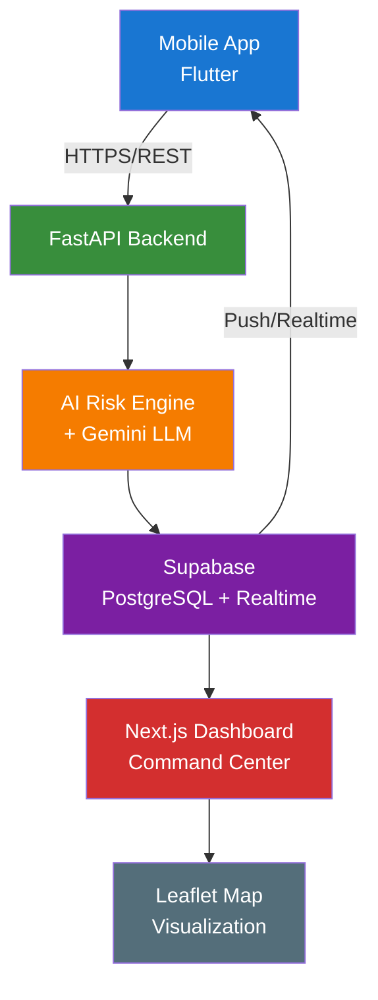

# Proactive Guard — System Architecture

## High-Level Architecture

```
┌─────────────────┐
│  Mobile App     │
│  (Flutter)      │
│                 │
│  • SOS Button   │
│  • Live Journey │
│  • Sensors      │
└────────┬────────┘
         │ HTTPS / REST
         ▼
┌─────────────────┐
│  FastAPI        │
│  Backend        │
│                 │
│  • Telemetry    │
│  • Incidents    │
│  • Journeys     │
│  • Auth         │
└────────┬────────┘
         │
         ▼
┌─────────────────┐
│  AI Risk Engine │
│  + Gemini LLM   │
│                 │
│  • Risk Score   │
│  • Severity     │
│  • AI Summary   │
│  • Decisions    │
└────────┬────────┘
         │
         ▼
┌─────────────────┐
│  Supabase       │
│  (PostgreSQL)   │
│                 │
│  • incidents    │
│  • journeys     │
│  • users        │
│  • telemetry    │
│  • Realtime     │
└────────┬────────┘
         │
    ┌────┴────┐
    ▼         ▼
┌─────────┐ ┌─────────────────┐
│ Next.js │ │  Flutter App    │
│Dashboard│ │  (Push/Notif)   │
│         │ │                 │
│• Map    │ │• Alerts         │
│• List   │ │• Status         │
│• Realtime│                  │
└─────────┘ └─────────────────┘
```

---

## Component Details

### 1. Mobile App (Flutter)
**Location:** `mobile/`

| Layer | Technology | Responsibility |
|-------|------------|----------------|
| UI | Flutter/Dart | SOS button, journey tracking, maps |
| Sensors | `location`, `audio`, `motion` packages | GPS, microphone, accelerometer |
| Network | `http` package | REST calls to FastAPI |
| State | Provider/Riverpod | App state management |
| Platform | Android (primary), iOS | Deployment target |

**Key Files:**
- `lib/main.dart` — App entry point
- `lib/screens/home_screen.dart` — Main dashboard
- `lib/screens/start_journey_screen.dart` — Journey initiation
- `lib/services/api.dart` — Backend communication
- `lib/services/location.dart` — GPS tracking
- `lib/services/audio.dart` — Audio level monitoring
- `lib/services/motion.dart` — Accelerometer monitoring
- `lib/utils/constants.dart` — Backend URL configuration

---

### 2. FastAPI Backend
**Location:** `backend/`

| Layer | Technology | Responsibility |
|-------|------------|----------------|
| Framework | FastAPI (Python 3.11+) | REST API, OpenAPI docs |
| ASGI | Uvicorn | Production server |
| Validation | Pydantic v2 | Request/response models |
| Database | Supabase Client (PostgreSQL) | Data persistence |
| AI | Google Gemini API + Custom Risk Engine | Risk assessment |
| Auth | JWT (planned) | User authentication |

**API Endpoints:**
```
GET    /                    → Health check
GET    /ping                → Detailed health
POST   /api/v1/telemetry    → Receive sensor data
POST   /api/v1/incidents/sos → SOS trigger
GET    /api/v1/incidents    → List incidents
GET    /api/v1/incidents/{id} → Incident details
POST   /api/v1/journeys     → Start journey
GET    /api/v1/journeys/{id} → Journey status
```

**Key Files:**
- `app/main.py` — FastAPI app, routes
- `app/api/routes/telemetry.py` — Telemetry ingestion
- `app/api/routes/incidents.py` — Incident management
- `app/api/routes/journeys.py` — Journey tracking
- `app/services/supabase.py` — Database client
- `app/services/llm.py` — Gemini integration
- `app/core/config.py` — Settings management
- `app/models/schemas.py` — Pydantic models

---

### 3. AI Risk Engine + Gemini
**Location:** `backend/ai-engine/`

| Component | Technology | Responsibility |
|-----------|------------|----------------|
| Risk Engine | Pure Python (`risk.py`) | Rule-based risk scoring (0-100) |
| LLM Integration | Google Gemini API | Narrative summaries, decisions |
| Fallback | Rule-based only | Works without API key |

**Risk Factors:**
- Audio Level (1-10) — Weight: 60%
- Motion Speed (1-10) — Weight: 40%
- Time of Day — Night bonus (22:00-06:00)
- Off-Route Detection — Route deviation bonus

**Severity Levels:**
| Score | Level | Action |
|-------|-------|--------|
| 0-34 | SAFE | Monitor only |
| 35-54 | MONITOR | Check-in prompt |
| 55-74 | HIGH RISK | Alert contacts |
| 75-100 | CRITICAL | Dispatch emergency |

**Key Files:**
- `ai-engine/risk.py` — `calculate_risk()`, `evaluate_risk()`, `generate_ai_summary()`
- `app/services/llm.py` — Gemini client wrapper

---

### 4. Supabase / PostgreSQL
**Hosted:** Supabase Cloud

**Tables:**
```sql
-- Core incident tracking
CREATE TABLE incidents (
    id UUID PRIMARY KEY DEFAULT gen_random_uuid(),
    incident_id TEXT UNIQUE NOT NULL,
    user_id TEXT NOT NULL,
    severity TEXT CHECK (severity IN ('SAFE','MONITOR','HIGH RISK','CRITICAL')),
    risk_score INTEGER CHECK (risk_score BETWEEN 0 AND 100),
    latitude DOUBLE PRECISION,
    longitude DOUBLE PRECISION,
    summary TEXT,
    audio_level INTEGER,
    motion_level INTEGER,
    time_of_day INTEGER,
    is_off_route BOOLEAN DEFAULT FALSE,
    created_at TIMESTAMPTZ DEFAULT NOW()
);

-- Journey tracking
CREATE TABLE journeys (
    id UUID PRIMARY KEY DEFAULT gen_random_uuid(),
    journey_id TEXT UNIQUE NOT NULL,
    user_id TEXT NOT NULL,
    start_lat DOUBLE PRECISION,
    start_lng DOUBLE PRECISION,
    end_lat DOUBLE PRECISION,
    end_lng DOUBLE PRECISION,
    planned_route JSONB,
    status TEXT CHECK (status IN ('active','completed','emergency')),
    started_at TIMESTAMPTZ DEFAULT NOW(),
    ended_at TIMESTAMPTZ
);

-- Telemetry log (optional, for analytics)
CREATE TABLE telemetry_log (
    id BIGSERIAL PRIMARY KEY,
    user_id TEXT NOT NULL,
    latitude DOUBLE PRECISION,
    longitude DOUBLE PRECISION,
    audio_score FLOAT,
    motion_score FLOAT,
    risk_score INTEGER,
    recorded_at TIMESTAMPTZ DEFAULT NOW()
);

-- Enable Realtime for incidents
ALTER PUBLICATION supabase_realtime ADD TABLE incidents;
```

**Features Used:**
- PostgreSQL database
- Row Level Security (RLS)
- Realtime subscriptions (dashboard auto-updates)
- REST API (direct dashboard access)
- Auth (planned)

---

### 5. Next.js Command Center (Dashboard)
**Location:** `dashboard/`

| Layer | Technology | Responsibility |
|-------|------------|----------------|
| Framework | Next.js 14 (App Router) | React framework |
| Styling | Tailwind CSS | Utility-first CSS |
| Map | Leaflet + React-Leaflet | Interactive maps |
| State | React Query / SWR | Server state |
| Realtime | Supabase Realtime | Live incident updates |
| Deployment | Vercel | Hosting |

**Pages:**
- `/` — Dashboard home (incident list + map)
- `/incidents/[id]` — Incident detail view

**Components:**
- `IncidentList` — Real-time incident feed
- `IncidentCard` — Individual incident display
- `LiveMap` — Leaflet map with severity markers
- `MapLegend` — Severity color key
- `SeverityBadge` — Color-coded severity label

**Key Files:**
- `src/app/page.tsx` — Main dashboard
- `src/app/incidents/[id]/page.tsx` — Detail view
- `src/components/LiveMap.tsx` — Map component
- `src/hooks/useIncidents.ts` — Data fetching + realtime
- `src/lib/supabase.ts` — Supabase client
- `src/lib/types.ts` — TypeScript types

---

### 6. Leaflet Map (Shared)
**Used in:** Dashboard (`LiveMap.tsx`) and Mobile (planned)

**Features:**
- OpenStreetMap tiles (free)
- Color-coded circle markers by severity
- Popup with incident details
- Auto-fit bounds to show all incidents
- Legend overlay

**Severity Colors:**
| Level | Color | Hex |
|-------|-------|-----|
| CRITICAL | Red | `#EF4444` |
| HIGH RISK | Orange | `#F97316` |
| MONITOR | Yellow | `#EAB308` |
| SAFE | Green | `#22C55E` |

---

## Data Flow Sequence

### SOS Trigger Flow
```
1. User presses SOS (Flutter)
         │
         ▼
2. POST /api/v1/incidents/sos {user_id, lat, lng, audio, motion}
         │
         ▼
3. Backend validates → calls AI Risk Engine
         │
         ▼
4. Risk Engine returns {risk_score, severity, summary}
         │
         ▼
5. Backend inserts incident into Supabase
         │
         ▼
6. Supabase Realtime broadcasts to Dashboard
         │
         ▼
7. Dashboard updates IncidentList + LiveMap
         │
         ▼
8. (Optional) Push notification to user contacts
```

### Live Journey Telemetry Flow
```
1. Flutter sends periodic telemetry (every 10-30s)
         │
         ▼
2. POST /api/v1/telemetry {user_id, lat, lng, audio, motion}
         │
         ▼
3. Backend evaluates risk (lightweight)
         │
         ▼
4. If risk > threshold → create incident + alert
         │
         ▼
5. Journey position updated in Supabase
         │
         ▼
6. Dashboard shows live position on map
```

---

## Network & Security

### Local Development
```
Mobile (device) → ngrok → localhost:8000 (Backend)
Dashboard (browser) → localhost:3000 → localhost:8000 (Backend)
Backend → Supabase Cloud (HTTPS)
Backend → Gemini API (HTTPS)
```

### Production
```
Mobile → https://proactive-guard-api.onrender.com
Dashboard → https://proactive-guard.vercel.app
Backend → Supabase Cloud (HTTPS)
Backend → Gemini API (HTTPS)
```

### Security Measures
- All external communication over HTTPS
- Supabase RLS policies restrict data access
- API keys stored in environment variables only
- CORS configured for known origins
- JWT authentication (planned for Day 3+)

---

## Deployment Architecture

```
┌──────────────┐     ┌──────────────┐
│   Vercel     │     │   Render     │
│  (Dashboard) │     │  (Backend)   │
│              │     │              │
│ Next.js 14   │────▶│ FastAPI      │
│ Static + SSR │     │ Uvicorn      │
└──────────────┘     └──────┬───────┘
                            │
                            ▼
                     ┌──────────────┐
                     │  Supabase    │
                     │  (PostgreSQL)│
                     │  + Realtime  │
                     └──────────────┘
                            │
                            ▼
                     ┌──────────────┐
                     │  Google      │
                     │  Gemini API  │
                     └──────────────┘
```

---

## Mermaid Diagram (For Documentation)



---

## Export Instructions

### To Generate PNG/SVG

**Option 1: Mermaid Live Editor (Easiest)**
1. Copy the Mermaid code above
2. Open https://mermaid.live/
3. Paste code
4. Click "Download" → PNG or SVG

**Option 2: VS Code + Mermaid Preview**
1. Install "Markdown Preview Mermaid Support" extension
2. Open `ARCHITECTURE.md` in VS Code
3. Open preview (Ctrl+Shift+V)
4. Right-click diagram → Save as SVG/PNG

**Option 3: CLI (mmdc)**
```bash
npm install -g @mermaid-js/mermaid-cli
mmdc -i docs/ARCHITECTURE.md -o docs/ARCHITECTURE.png
mmdc -i docs/ARCHITECTURE.md -o docs/ARCHITECTURE.svg
```

**Option 4: GitHub Rendering**
- GitHub natively renders Mermaid in `.md` files
- View on GitHub.com → right-click → Save image

---

## Architecture Decision Records (ADR)

| Decision | Rationale |
|----------|-----------|
| FastAPI over Flask/Django | Async, auto OpenAPI, type safety |
| Supabase over raw PostgreSQL | Realtime, Auth, REST API, Dashboard |
| Next.js over Create React App | SSR, App Router, Vercel native |
| Leaflet over Google Maps | Free, open-source, offline-capable |
| Rule-based AI + Gemini | Works offline, explainable, enhanced by LLM |
| Flutter for mobile | Single codebase, native performance, sensors |

---

## Scalability Considerations

| Component | Current | Scale Target | Strategy |
|-----------|---------|--------------|----------|
| Backend | 1 instance | 3+ instances | Horizontal scaling on Render |
| Database | Supabase Free | Pro/Enterprise | Connection pooling, read replicas |
| Realtime | 100 concurrent | 10,000+ | Supabase handles scaling |
| AI Engine | Sync in request | Async queue | Celery + Redis (future) |
| Dashboard | Vercel Edge | Global CDN | Automatic |

---

*Last Updated: Day 2 — Member 6 (Integration Lead)*
*Version: 1.0*